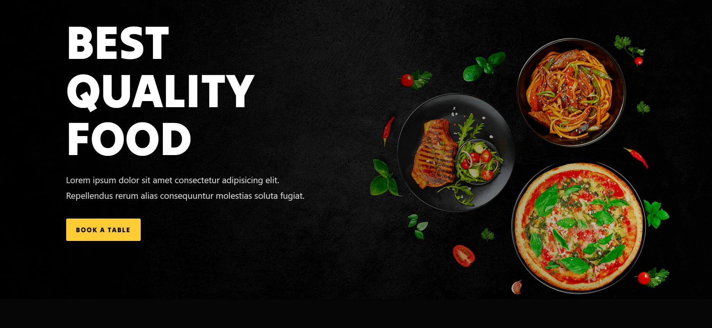

# RestFood
A responsive food ordering web app built with React.

## [**View Live Demo**](https://restfood-website.vercel.app/)



## Features
- [Feature 1, e.g. browse menu]
- [Feature 2, e.g. add to cart]
- [Feature 3]

## Tech Stack
React.js, React Router, Vite, Bootstrap, JavaScript. Deployed on Vercel.

## Run Locally
```bash
git clone https://github.com/rawanelgaml23/restfood-website.git
cd restfood-website
npm install
npm run dev
```
